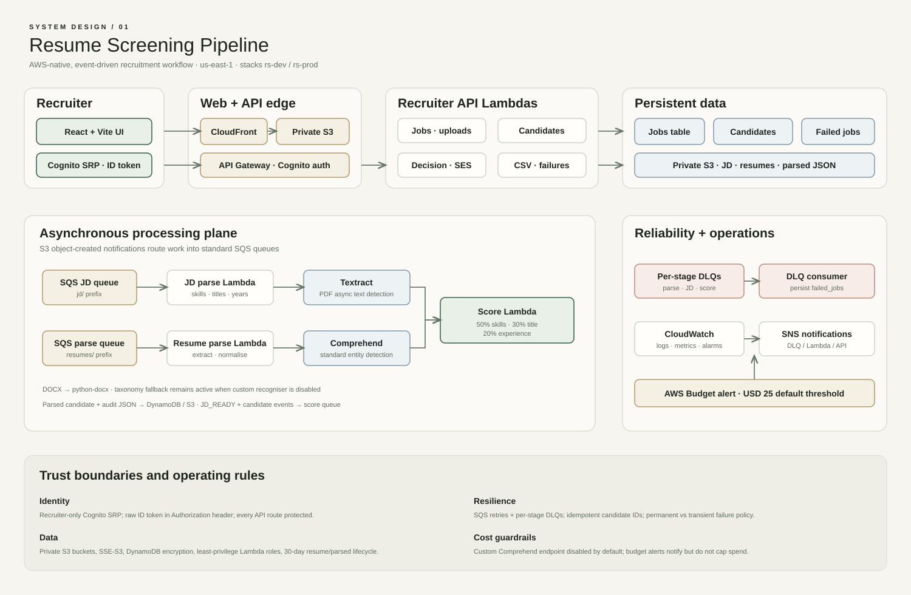
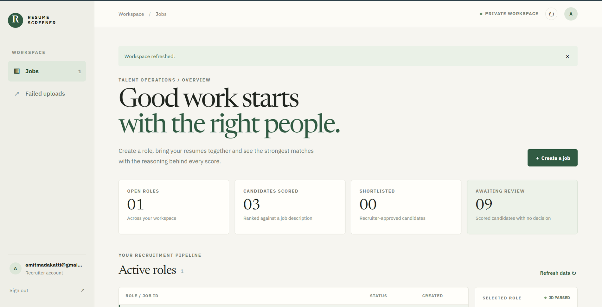
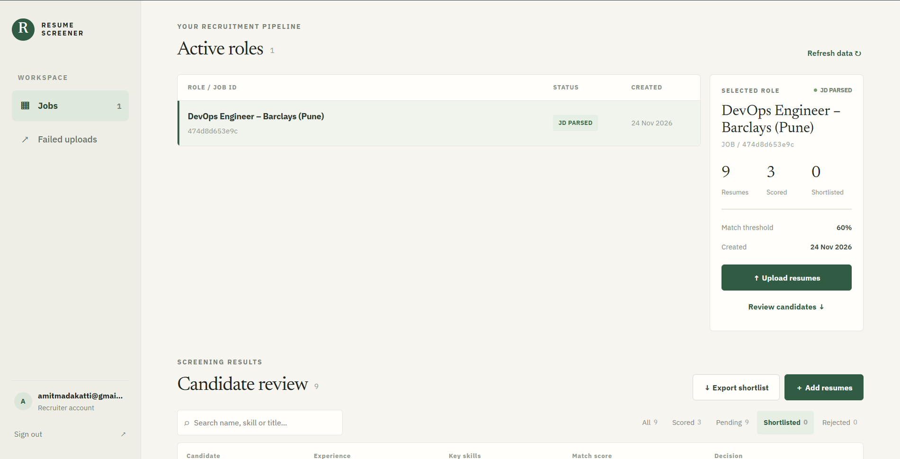
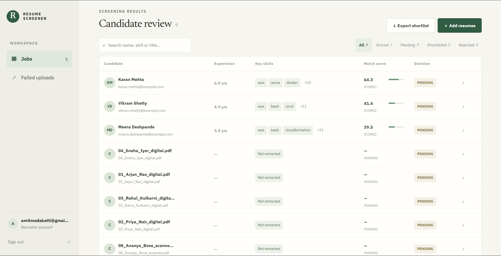
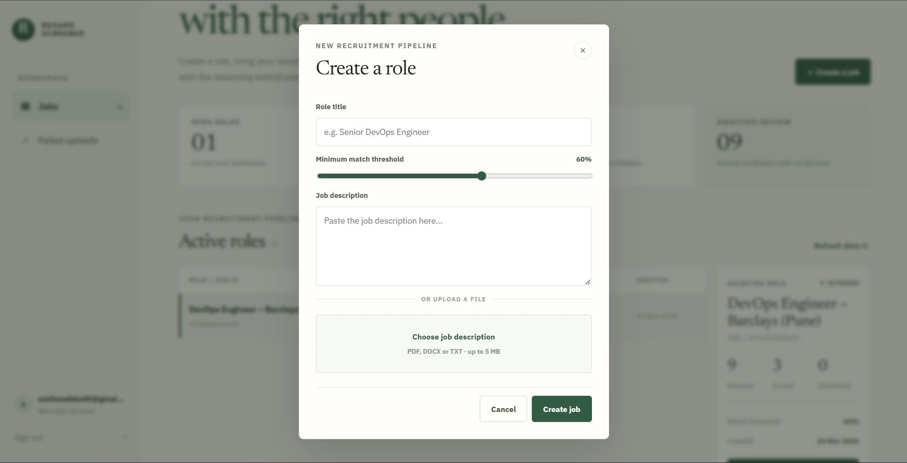
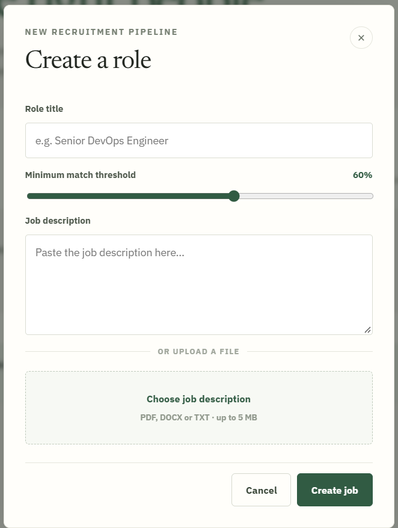
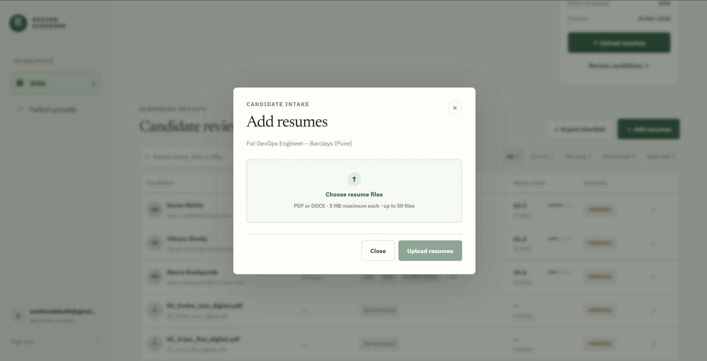
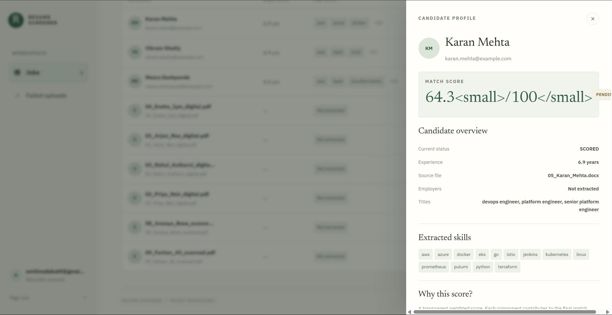
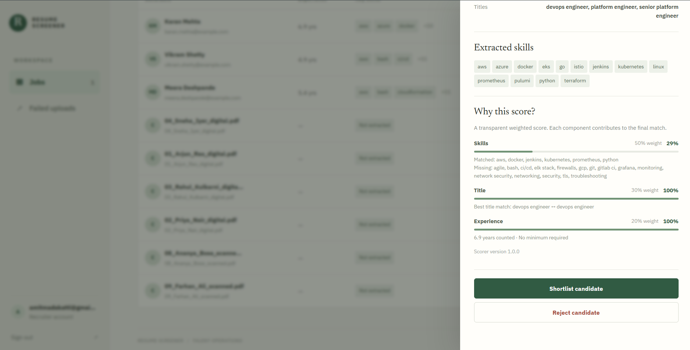
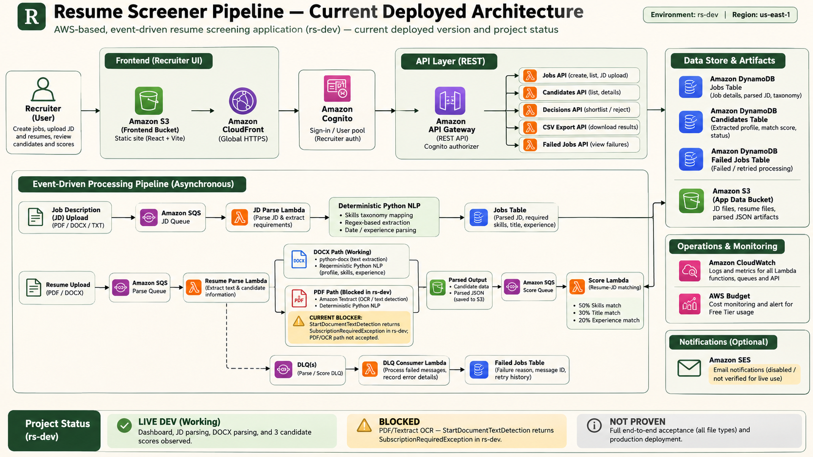

# AI Resume Screener & Talent Acquisition Pipeline

An AWS-based, event-driven resume screening application. Recruiters create a job, submit a job description, upload resumes, and review extracted candidate profiles and explainable match scores.

> **Project closeout snapshot — 25 November 2026**
>
> This repository now contains the integrated team implementation and project closeout. The project is a **working development prototype with a documented PDF/OCR service-access blocker**. Merging the code to GitHub `main` does not mean the AWS backend was promoted or that the application is production-ready.

## Current status at a glance

| Area | Evidence-based status |
|---|---|
| Recruiter sign-in and dashboard | Observed working in the deployed development frontend |
| Job creation and JD parsing | Observed working; Barclays DevOps Engineer (Pune) job displayed as `JD PARSED` |
| Resume upload | Nine valid synthetic resumes uploaded to the dev job |
| DOCX extraction and candidate scoring | Three DOCX candidates extracted and scored in the live dev environment |
| PDF extraction / scanned PDF OCR | Blocked: live Textract call returns `SubscriptionRequiredException` |
| Candidate scoring | Three live scores observed; deterministic scoring implementation and unit tests exist |
| Frontend publishing | Build/typecheck passed, S3 sync succeeded, CloudFront invalidation reached `Completed` |
| Full live E2E acceptance | Not passed; six PDF candidates remained in `PARSING` during the observed run |
| Production | Not deployed or promoted by this closeout |

**Observed live test:** 9 valid synthetic resumes uploaded to job `474d8d653e9c`; 3 DOCX candidates reached `SCORED`; 6 PDF candidates remained `PARSING`. Parse-queue metrics showed 6 messages not visible and 0 visible. Parse Lambda logs showed Textract `StartDocumentTextDetection` failing with `SubscriptionRequiredException`. Score queue was empty at the time of inspection.

## Architecture



Editable diagram source: [docs/architecture.mmd](docs/architecture.mmd). A high-resolution architecture image is also provided at [docs/architecture/current-deployed-architecture.png](docs/architecture/current-deployed-architecture.png).

## Product screenshots

The dashboard screenshots are committed in [`docs/screenshots/`](docs/screenshots/). Read the evidence notes in [`docs/screenshots/README.md`](docs/screenshots/README.md); these dated captures document the development UI and are not a claim of production readiness.

The editable architecture diagram is versioned at [`docs/architecture.svg`](docs/architecture.svg), with its source at [`docs/architecture.mmd`](docs/architecture.mmd). The supplied high-resolution raster diagram is committed at [`docs/architecture/current-deployed-architecture.png`](docs/architecture/current-deployed-architecture.png).

### Dashboard gallery

> Dated development captures from 25 November 2026. These are evidence of the observed development UI, not a production-readiness claim.



| Workflow | Screenshot |
|---|---|
| Active roles and selected-job summary |  |
| Candidate review table |  |
| Create-role dialog |  |
| Create-role dialog detail |  |
| Batch resume upload |  |
| Candidate profile |  |
| Score explanation and recruiter decisions |  |

### Architecture image



## Implemented application capabilities

- Recruiter authentication with Amazon Cognito SRP flow.
- React, Vite and TypeScript recruiter workspace delivered through CloudFront and a private S3 frontend origin.
- Job creation, JD upload/text input, job listing and job details.
- Presigned S3 resume uploads with file validation and per-file progress.
- S3 event notifications and SQS-driven asynchronous JD/resume processing.
- DOCX extraction using `python-docx`.
- Deterministic skill taxonomy, email/name/title/employer derivation and experience-range extraction.
- Candidate persistence and parsed JSON artifacts in S3.
- Deterministic explainable scoring: 50% skills, 30% title and 20% experience.
- Candidate listing/detail, search/filtering, shortlist/reject workflow and shortlist CSV export.
- Failed-job records, retry API and SQS dead-letter queue consumer.
- CloudWatch logs/metrics and infrastructure definitions for alarms and AWS Budget notifications.
- CI verification, SAM template validation/build, synthetic fixtures and golden evaluation.

See [docs/PROJECT_CLOSEOUT.md](docs/PROJECT_CLOSEOUT.md) for the detailed implementation inventory, live evidence, known limitations and next steps.

## AWS service-access limitation

The live development parser invoked:

```text
textract.start_document_text_detection(...)
SubscriptionRequiredException:
The AWS Access Key Id needs a subscription for the service
```

This is an account/service-access failure returned by the Textract API. The available evidence does **not** establish that Textract is categorically unavailable on AWS Free Tier, nor does it identify the precise account eligibility or enrollment cause. The repository therefore records the observed error without making a blanket Free Tier claim.

Amazon Comprehend was removed from the integration implementation in favour of deterministic Python extraction. Textract remains in the current PDF parsing path. A future cost-conscious improvement is to extract text locally from digital PDFs and use a separately packaged local OCR engine for scanned PDFs, eliminating the Textract runtime dependency. That alternative has **not** been implemented or deployed in this snapshot.

## Repository map

| Path | Purpose |
|---|---|
| `backend/parsing/` | Resume/JD parsing, deterministic NLP, taxonomy and DLQ consumer |
| `backend/scoring/` | Deterministic scoring library and SQS scoring Lambda |
| `backend/api/` | Jobs, candidates, decisions, export and failed-job APIs |
| `infra/template.yaml` | AWS SAM infrastructure |
| `frontend/` | React/Vite recruiter application |
| `contracts/` | OpenAPI, JSON and SQS contracts |
| `fixtures/` | Synthetic job, resume, candidate and failure fixtures |
| `tests/e2e/` | Guarded live smoke test and offline checks |
| `docs/STATE.md` | Current evidence-based status |
| `docs/PROJECT_CLOSEOUT.md` | Mentor-ready project closeout and limitations |
| `docs/architecture.mmd` | Editable Mermaid architecture source |
| `docs/architecture.svg` | Architecture diagram included in this README |
| `docs/architecture.svg` | Current architecture diagram included above |
| `docs/architecture.mmd` | Editable Mermaid architecture source |
| `docs/screenshots/` and `docs/architecture/current-deployed-architecture.png` | Supplied in the separate repository asset ZIP; add by extracting at repository root |
| `docs/RESOURCES.md` | AWS resource inventory and cleanup guidance |

## Verification

Repository CI and local tests are distinct from live AWS acceptance. Historical CI evidence is recorded in [docs/STATE.md](docs/STATE.md) and [docs/PROJECT_CLOSEOUT.md](docs/PROJECT_CLOSEOUT.md). The repository includes:

```bash
pip install -r requirements-dev.txt
make golden-generate
make verify
make sam-validate
make sam-build
```

A successful unit test, Moto integration test or SAM build does not prove that the deployed AWS account can access every managed service.

## Development deployment

The observed development frontend is:

- URL: https://d2sdkmafcw9mpe.cloudfront.net
- CloudFront distribution: `E3NI28CL1V2SX4`
- Frontend bucket: `rs-dev-frontend-924422830139`
- Region: `us-east-1`
- Stack: `rs-dev`

The frontend publish command completed successfully on 25 November 2026. CloudFront invalidation status was verified as `Completed`.

The previously recorded API endpoint is `https://pidp0mxkc6.execute-api.us-east-1.amazonaws.com/v1/`. Treat deployed backend code/version as **not reconciled to the integrated GitHub `main` commit** until the stack/template and Lambda code versions are checked. The live DOCX success and Textract failure above are runtime observations, not proof that every component from the current branch is deployed.

**Repository status:** the integrated application is merged into GitHub `main`. **AWS boundary:** `rs-dev` was not redeployed as part of the GitHub merge and `rs-prod` was not changed. No production promotion, production deployment, resource deletion or database/queue cleanup was performed.

## Team contribution and project context

This was developed as a collaborative team project during the F13 Technologies AWS Cloud internship. The integrated application is present on `main`. Verified teammate-authored commits were recovered from the historical feature branches: Gopi Krishna (`dggk78`) contributed the A1 skills taxonomy and A2–A10 parsing pipeline; Sushmitha M (`sush-kush`) contributed B1–B8 scoring and recruiter API modules. Amit (`amit-cloudops-ai`) led integration, infrastructure and project closeout. See [`docs/CONTRIBUTIONS.md`](docs/CONTRIBUTIONS.md) for the evidence and module-level detail. The final integration used squash merges, so GitHub's Contributors panel may not reflect the full team roster.

## Security, cost and operational notes

- Do not commit AWS credentials, Cognito tokens, real resumes or candidate personal data.
- The test resumes used for the live demonstration are fictional synthetic records.
- The AWS Budget is an alert threshold, not a hard spending cap.
- Review actual account usage and current AWS pricing before enabling managed services or increasing test volume.
- Resume screening is decision support. Human review and a fairness/bias assessment are required before operational hiring use.
- Confirm retention/deletion requirements for candidate records and JD artifacts before production use.

## Project status

**Suitable for an interim mentor demonstration and repository review.** The deployed dev application demonstrates recruiter access, JD parsing, DOCX resume processing and candidate scoring. PDF/OCR processing is blocked by the recorded Textract service-access error; complete live E2E acceptance and production readiness remain open.
